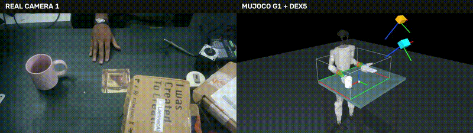

# Stereo-Vision Real2Sim Transfer
### Human Hand Motion Retargeting to Unitree G1 with DEX5

A vision-based Real2Sim pipeline that reconstructs human hand and wrist movements from recorded camera footage and transfers the motion to a **Unitree G1 humanoid equipped with a DEX5 hand**, visualized in MuJoCo.

The project explores how human demonstrations can be converted into robot joint trajectories using stereo vision, hand pose estimation, depth reconstruction, and inverse kinematics.

## Demonstration

The demonstration shows recorded human hand motion alongside the corresponding G1/DEX5 simulation.



[View the demonstration video](docs/media/real2sim_demo.mp4)

## Overview

The pipeline processes recorded human motion through the following stages:

**Camera Recording → Hand Segmentation → Depth Reconstruction → Hand Landmark Tracking → Wrist Pose Estimation → DEX5 Retargeting → MuJoCo Replay**

The system combines visual tracking with geometric reconstruction to generate a trajectory that can be replayed on the humanoid model.

## Implementation

### 1. Stereo Camera Recording and Calibration

Multiple camera views are used to capture human hand movements.

Camera calibration establishes the intrinsic and extrinsic parameters required for stereo reconstruction. A table reference frame is used to map reconstructed positions into the simulation coordinate system.

### 2. Hand and Wrist Tracking

The recorded video is processed to estimate human hand motion.

The implementation uses:

- **MediaPipe** for hand landmark detection.
- **SAM3** for segmentation of the wristband region.
- **FoundationStereo** for stereo depth estimation.
- Stereo geometry and calibration data for reconstructing 3D wrist positions.

### 3. Human-to-Robot Retargeting

Human hand motion is transferred to the robot using geometric mapping and inverse kinematics.

The pipeline generates:

- Reconstructed 3D wrist positions.
- Estimated wrist and palm orientations.
- DEX5 finger joint trajectories.
- G1 arm configurations that follow the reconstructed wrist trajectory.

### 4. MuJoCo Simulation

The generated robot trajectories are replayed in MuJoCo using the G1 humanoid and DEX5 hand models.

The replay provides a visual comparison between recorded human motion and the corresponding simulated robot motion.

## Repository Structure

| Directory / File | Description |
|---|---|
| `real2sim` | Main command-line interface |
| `code/` | Tracking, reconstruction, retargeting, and simulation scripts |
| `code/stereo/` | Camera recording and calibration |
| `integrations/foundationstereo/` | Custom stereo-depth integration script |
| `models/` | G1/DEX5 simulation models and assets |
| `tools/` | Supporting processing and visualization utilities |
| `docs/WORKFLOW.md` | Complete processing and reproduction procedure |
| `docs/media/` | Demonstration media |
| `SETUP.md` | Environment setup instructions |

## Getting Started

### 1. Clone the Repository

```bash
git clone https://github.com/Terminator110/stereo-vision-real2sim-transfer.git
cd stereo-vision-real2sim-transfer
```

### 2. Set Up the Environment

Follow [SETUP.md](SETUP.md) to configure the Python environments and install the required dependencies, including FoundationStereo.

### 3. Verify the Installation

```bash
./real2sim doctor
```

This checks the local environment and required components.

### 4. Record and Process a Demonstration

The processing workflow covers:

1. Camera calibration.
2. Recording a human hand demonstration.
3. Wristband segmentation and stereo depth reconstruction.
4. Hand pose tracking and trajectory generation.
5. Retargeting the reconstructed motion to G1/DEX5.
6. Replaying the resulting trajectory in MuJoCo.

The full commands, file locations, and processing sequence are documented in:

**[Complete Real2Sim Workflow](docs/WORKFLOW.md)**

## Current Results

The implemented pipeline supports the reconstruction of wrist motion from recorded camera footage and generation of corresponding G1/DEX5 simulation trajectories.

The workflow has been demonstrated through video-based human-to-robot motion replay.

The current implementation is a **kinematic retargeting and simulation pipeline**. Reliable object grasping and manipulation are not yet demonstrated.

## Project Focus

This project focuses on reconstructing human hand motion from video and transferring it to a humanoid robot simulation.

Its primary objective is to provide a reproducible workflow for studying **vision-based human-to-humanoid motion retargeting**.